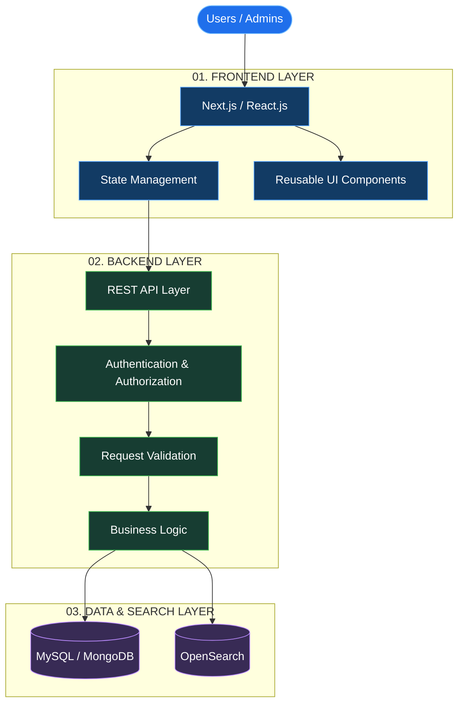
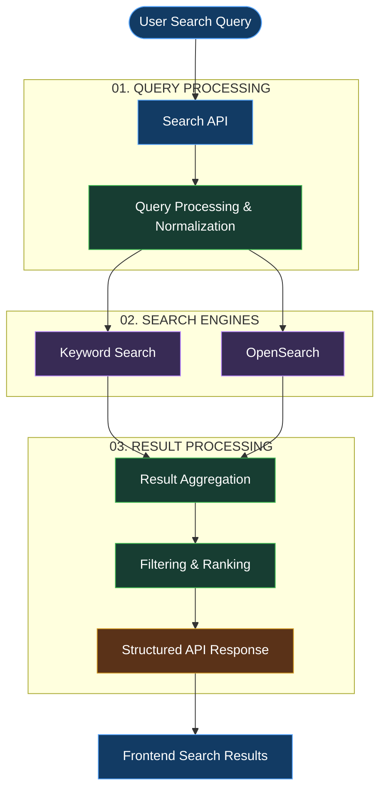
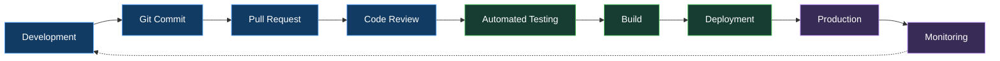

<!-- ========================================================= -->
<!--                 SHIVAKANT OJHA | GITHUB                   -->
<!--              FULL STACK ENGINEER PORTFOLIO                -->
<!-- ========================================================= --><!-- ================= HERO SECTION ================= -->

Building software that solves real problems and scales with purpose.

<!-- ================= ENGINEERING IDENTITY ================= -->01. / Engineering Identity
I'm Shivakant Ojha, a Full Stack Engineer from India with 2+ years of hands-on experience building and maintaining production web applications.

I work at the intersection of engineering, performance, and business logic.

My experience includes working on live platforms, engineering application workflows, optimizing APIs, implementing search systems, and building solutions designed for real users.

I believe great engineering goes beyond making features work. It's about building systems that are maintainable, reliable, performant, and valuable to the business.
const shiva = {
  role: "Full Stack Engineer",
  experience: "2+ Years",

  engineeringFocus: [
    "Production Web Applications",
    "Scalable Backend Systems",
    "Frontend Architecture",
    "API Development & Optimization",
    "Search & Automation Systems"
  ],

  technologies: {
    frontend: ["React", "Next.js", "TypeScript"],
    backend: ["Node.js", "Express.js"],
    databases: ["MySQL", "MongoDB", "OpenSearch"]
  },

  currentlyExploring: [
    "AI Engineering",
    "LLM Integrations",
    "System Design"
  ],

  philosophy: "Think. Engineer. Optimize. Scale."
};
<!-- ================= SYSTEM ARCHITECTURE ================= -->02. / System Architecture
I approach software development by thinking beyond individual components — focusing on how frontend applications, backend services, APIs, and data systems communicate to deliver reliable products.
01 — Production Web Application Architecture

Architecture principles
- Separation of concerns and modular design.
- Reusable and maintainable frontend components.
- Secure API communication and authentication.
- Structured database management.
- Search integration and efficient data retrieval.
- Performance-oriented application design.
Note: This is a representative architecture of full-stack systems, not a claim that every component is deployed in every project.
02 — Hybrid Search Architecture
One of my interesting engineering areas is working with search functionality, including OpenSearch and keyword-based search.

The following diagram illustrates a conceptual hybrid search workflow.

Search engineering concepts
- Query processing and normalization.
- Keyword-based matching.
- OpenSearch integration.
- Result aggregation.
- Relevance-based filtering and ranking.
- Efficient API response handling.
The exact search pipeline depends on the project implementation. This diagram illustrates the general hybrid-search concept.
03 — Software Engineering & CI/CD Lifecycle
Understanding how software moves from development to production is an important part of engineering reliable applications.

Engineering workflow principles
- Version control and collaborative development.
- Code reviews and maintainability.
- Automated quality checks and testing.
- Build and deployment processes.
- Production validation and monitoring.
- Continuous improvement.
This represents a reference CI/CD workflow, not a claim that all stages are currently automated in my projects.
<!-- ================= PRODUCTION PROJECTS ================= -->03. / Production Engineering
01 — WholesaleDeals
B2B Wholesale Marketplace

Contributed to a production marketplace connecting suppliers and buyers through deal management and business workflows.

Engineering contributions
- Engineered and optimized deal management functionality.
- Implemented hybrid search using OpenSearch and keyword-based search.
- Worked on API performance optimization and data handling.
- Contributed to supplier and buyer workflow systems.
- Engineered admin panel functionality and management features.
Technology Stack

React.js Next.js Node.js Express.js OpenSearch MySQL
02 — NexBrass
Industrial & Product-Based Business Website

Worked on frontend implementation and website development for an industrial business platform.

Engineering contributions
- Website development and frontend integrations.
- Responsive layouts and user experience improvements.
- Performance and SEO enhancements.
- Reusable interface elements.
Technology Stack

React.js JavaScript HTML CSS SEO
03 — WholesaleLinks India
Supplier & Wholesale Directory Platform

Contributed to a directory-style platform designed to organize supplier information and wholesale opportunities.

Engineering contributions
- Frontend system development.
- Data handling and structured content management.
- Feature enhancements and UI improvements.
- Application optimization and maintenance.
Technology Stack

React.js JavaScript REST APIs MySQL
<!-- ================= TECHNICAL SKILLS ================= -->04. / Technical Arsenal

FRONTEND ENGINEERING

BACKEND ENGINEERING

DATABASE & SEARCH

TOOLS & INFRASTRUCTURE

<!-- ================= ENGINEERING FOCUS ================= -->05. / Engineering Focus
Domain	Engineering Focus
Frontend	Component Architecture, State Management, SSR
Backend	REST APIs, Business Logic, Authentication
Database	Query Optimization, Data Modeling
Search	OpenSearch, Keyword Search, Hybrid Search
Performance	API Optimization, SEO, Core Web Vitals
Systems	Automation, Scalable Architecture

<!-- ================= CURRENTLY EXPLORING ================= -->06. / Currently Exploring
01  AI Engineering & LLM-Powered Applications
02  Advanced Next.js Architecture
03  System Design & Distributed Systems
04  Backend Scalability & Performance
05  AI-Powered Business Automation
I'm interested in building intelligent applications that combine modern web technologies with practical AI capabilities.
<!-- ================= GITHUB ANALYTICS ================= -->07. / GitHub Intelligence

<!-- ================= BEYOND CODE ================= -->08. / Beyond the Code
- I enjoy understanding complex business requirements.
- I believe clean architecture saves more time than quick fixes.
- I prefer solving real engineering problems over building repetitive demos.
- I continuously explore modern technologies and better engineering practices.
- I believe good software is a combination of technical quality and business value.
<!-- ================= OPPORTUNITIES ================= -->09. / Open to Opportunities
I'm interested in connecting with engineering teams, founders, and companies building meaningful products.

Interested Roles
- Full Stack Engineer
- React.js / Next.js Developer
- Software Engineer
- Full Stack + AI Engineer
Let's build something that matters.

Think Deeply. Engineer Intelligently. Build Fearlessly.

<!-- ========================================================= -->
<!--                  END OF README                            -->
<!-- ========================================================= -->
